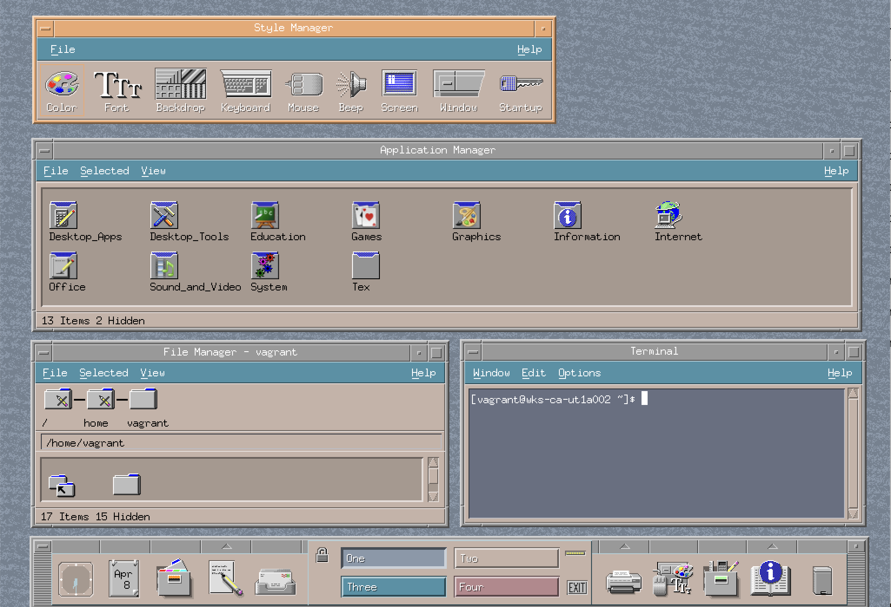

# hypr-motif

Common Desktop Environment (Motif) window chrome for Hyprland, drawn procedurally with
Cairo at runtime — there are no image assets.



## Features

- Fielded Motif title bar: close on the left, float and fullscreen on the right, each in
  its own separator-delimited field.
- Aliased title text with a hard 1px shadow, centred in the title field.
- Bar dragging and bottom-corner resizing.
- Separate palette for the focused window.
- Per-window rules to hide the bar, the title text or the frame (below).
- `hyprctl cde clients` reports the outer window rect, chrome included.

## Install

```sh
# hyprpm
hyprpm add https://github.com/preprocessor/hypr-motif
hyprpm enable cde
```

```sh
# from source; nix develop supplies the matching toolchain
nix develop
make                # or: cmake -B build && cmake --build build
```

Load it with `hyprctl plugin load /path/to/cde.so`, or from your config:

```ini
plugin = /path/to/cde.so
```

## Config

All options are under `plugin:cde` (Lua: `hl.config({ plugin = { cde = { … } } })`):

```ini
plugin {
    cde {
        bar_height = 22
    }
}
```

| property | type | default | description |
| --- | --- | --- | --- |
| `bar_height` | int | `22` | bar height in logical pixels, min 16 |
| `show_buttons` | bool | `true` | draw the three title bar buttons |
| `show_titlebar` | bool | `true` | draw the title bar (and the bar's corner grab rules) |
| `show_border` | bool | `true` | draw the left, right and bottom frame |
| `show_title` | bool | `true` | draw the title text; the fields and drag rules stay |
| `title_font` | string | `Chicago` | title font family, any fontconfig name |
| `title_font_size` | int | `12` | title size in points, min 6 |
| `color_face` | color | `#999999` | bar face, unfocused |
| `color_light` | color | `#d1d1d1` | bevel highlight, unfocused |
| `color_dark` | color | `#4e4e4e` | bevel shadow, unfocused |
| `color_title` | color | `#b0b0b0` | title text, unfocused |
| `color_face_active` | color | `#eda870` | bar face, focused |
| `color_light_active` | color | `#f7d9c0` | bevel highlight, focused |
| `color_dark_active` | color | `#7d593b` | bevel shadow, focused |
| `color_title_active` | color | `#ffffff` | title text, focused |
| `color_title_shadow` | color | `#000000` | the title's hard 1px drop shadow |

## Window rules

**Every rule is a config key.** Rule `cde:X` overrides option `plugin:cde:X` on the
windows it matches; a window without the rule inherits the option, and a rule that sets one
key leaves the others alone. There are twelve, one per option that can vary per window, and
no other rule names.

| rule | option (default) | what it changes on matching windows |
| --- | --- | --- |
| `cde:color_face` | `color_face` (`#999999`) | bar face while the window is **unfocused** |
| `cde:color_light` | `color_light` (`#d1d1d1`) | bevel highlight while unfocused |
| `cde:color_dark` | `color_dark` (`#4e4e4e`) | bevel shadow while unfocused |
| `cde:color_title` | `color_title` (`#b0b0b0`) | title text while unfocused |
| `cde:color_face_active` | `color_face_active` (`#eda870`) | bar face while the window is **focused** |
| `cde:color_light_active` | `color_light_active` (`#f7d9c0`) | bevel highlight while focused |
| `cde:color_dark_active` | `color_dark_active` (`#7d593b`) | bevel shadow while focused |
| `cde:color_title_active` | `color_title_active` (`#ffffff`) | title text while focused |
| `cde:color_title_shadow` | `color_title_shadow` (`#000000`) | the title's hard 1px drop shadow, focused or not |
| `cde:show_titlebar` | `show_titlebar` (`true`) | `false` hides the bar, its buttons and drag area; a 5px frame band stays |
| `cde:show_border` | `show_border` (`true`) | `false` hides the left, right and bottom frame |
| `cde:show_title` | `show_title` (`true`) | `false` hides only the title text; fields, buttons and drag rules stay |

The colours reach everything the option reaches: the bar face and bevel, the three buttons
and their hover, the field separators, the corner grab rules and the title. `color_title_shadow`
is one value for both focus states, so it is the only colour rule that does not come in an
`_active` pair.

Colours take the same syntax as the config file — `#rrggbb`, `rgb(rrggbb)`,
`rgba(rrggbbaa)` — and a value that cannot be parsed is ignored, leaving the configured
colour. Booleans take `true`/`false` (also `0`, `no`, `off`); a bare `[...] = true` counts
as true.

`cde:color_face` alone changes only the **unfocused** bar, so a focused window still paints
its `_active` palette. Set both to pin a window's colour across focus.

```lua
hl.window_rule({
    match = { class = "^kitty$" },
    ["cde:show_titlebar"] = false,
    ["cde:color_face"] = "rgb(2a2a2a)",
    ["cde:color_face_active"] = "rgb(3a3a3a)",
})
```

`rgba(...)` is accepted, but the chrome is opaque: the alpha channel is parsed and dropped,
the same as a config colour with alpha. Use a solid colour if in doubt.

**Upgrading from the old rules.** `cde:no_titlebar`, `cde:no_border` and `cde:no_title` were
removed and are not replaced by aliases — rename them and invert the value, or the Lua config
backend rejects the rule on the next reload:

| old | new |
| --- | --- |
| `["cde:no_titlebar"] = true` | `["cde:show_titlebar"] = false` |
| `["cde:no_border"] = true` | `["cde:show_border"] = false` |
| `["cde:no_title"] = true` | `["cde:show_title"] = false` |

A hidden strip reserves no space, so the window closes up over it; `show_titlebar = false`
with `show_border = true` leaves the 5px top frame band, and both together leave only the
client. A rule evaluated at a live window applies immediately — colours repaint and the
`show_*` flags re-lay the window out, no reload needed. Rules in the config file are read
at plugin load and on `hyprctl reload`.

## Reporting geometry

`hyprctl clients` reports the **client** rect: the bar and frame are excluded, by the same
rule for Hyprland's own decorations. A plugin cannot change that, so this one adds
`hyprctl cde clients` — the compositor's `clients -j` document with each window's `at` and
`size` rewritten to the outer rect, chrome included. The output is always JSON and the
outer rect is invariant under the window rules above, because the client absorbs the freed
space.
