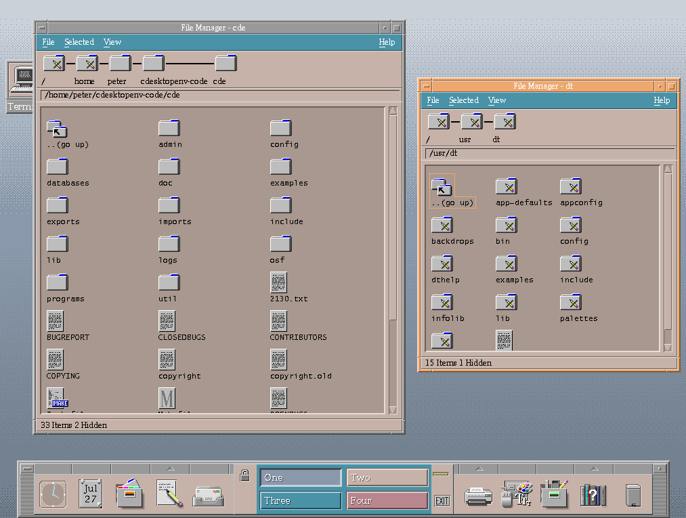

# hypr-CDE-borders

Common Desktop Environment (Motif) window chrome for Hyprland

Everything is drawn procedurally with Cairo at runtime — there are no image assets.



## Requirements

Built and verified against **hyprland 0.56.2**. There is no ABI stability across the
`dlopen` boundary: a plugin compiled against a different hyprland is rejected by, or takes
down, the compositor. Build this from the same hyprland you run.

## Install

### hyprpm

```
hyprpm add https://github.com/wyspr/hypr-CDE-borders
hyprpm enable cde
```

### From source

```sh
nix develop          # gcc 14.4, cmake, hyprland headers
make                 # or: cmake -B build && cmake --build build
```

Load it with `hyprctl plugin load /path/to/cde.so`, or from your config:

```ini
plugin = /path/to/cde.so
```

## Config

All options live under `plugin:cde`:

```ini
plugin {
    cde {
        bar_height = 22

        # Inactive (unfocused) window
        color_face = #999999
        color_light = #d1d1d1
        color_dark = #4e4e4e
        color_title = #b0b0b0

        # Active (focused) window
        color_face_active = #eda870
        color_light_active = #f7d9c0
        color_dark_active = #7d593b
        color_title_active = #ffffff

        # Shared
        color_title_shadow = #000000
        title_font_size = 12
        title_font = Chicago
        show_buttons = true
    }
}
```

| property | type | description | default |
| --- | --- | --- | --- |
| `bar_height` | int | title bar height in logical pixels, min 16 | `22` |
| `color_face` | color | bar face colour, inactive window | `#999999` |
| `color_light` | color | bevel highlight, inactive window | `#d1d1d1` |
| `color_dark` | color | bevel shadow, inactive window | `#4e4e4e` |
| `color_title` | color | title text, inactive window | `#b0b0b0` |
| `color_face_active` | color | bar face colour, focused window | `#eda870` |
| `color_light_active` | color | bevel highlight, focused window | `#f7d9c0` |
| `color_dark_active` | color | bevel shadow, focused window | `#7d593b` |
| `color_title_active` | color | title text, focused window | `#ffffff` |
| `color_title_shadow` | color | the title's hard 1px drop shadow | `#000000` |
| `title_font_size` | int | title size in points, min 6 | `12` |
| `title_font` | string | title font family (any fontconfig name) | `Chicago` |
| `show_buttons` | bool | draw the three title bar buttons | `true` |

## Window rules

Two rules switch parts of the chrome off, per window. A hidden part reserves no space, so
the window closes up over it. A third keeps the bar but drops its text.

| rule | effect |
| --- | --- |
| `cde:no_titlebar` | no title bar — no bar, buttons, title or drag area; the 5px frame stays |
| `cde:no_title` | no title text — the bar, buttons and fields stay, and the grabber bars span the whole title field |
| `cde:no_border` | no frame — nothing on the left, right or bottom edge |

```ini
windowrulev2 = cde:no_titlebar, class:^(kitty)$
windowrulev2 = cde:no_border, class:^(foot)$
```

Under a Lua config the effect name has to be a **quoted key**, or it reads as a syntax
error:

```lua
hl.window_rule({
  match = { class = "^kitty$" },
  ["cde:no_titlebar"] = true,
})
```

Both together hide everything. Like every other setting, a rule takes effect at plugin load
and at the next `hyprctl reload` — not from `hl.eval` alone.

## Reporting geometry

`hyprctl clients` reports the **client** rect — the title bar and frame are excluded, for
Hyprland's own decorations as much as for this plugin's. That is not overridable from a
plugin; no API lets one change what that command prints.

`hyprctl cde clients` is this plugin's answer. It is `hyprctl clients -j` with the `at` and
`size` of every window rewritten to the **outer** rect, chrome included. Everything else —
every field, the field order, the window order — is the compositor's own output:

```
$ hyprctl cde clients
[{
    "address": "0x5e86c8e02a40",
    "at": [440, 0],
    "size": [2560, 1440],
    "class": "vesktop",
    ...
}]
```

Output is always JSON, `-j` or not. The outer rect is the window's actual box, so it does not
move when a window rule above hides part of the chrome — the client absorbs the space
instead, and only `hyprctl clients` changes.

## Interaction

| where | what it does |
| --- | --- |
| bare bar | drag to move the window. This is the compositor's own drag, so `binds:drag_threshold`, float-on-drag, snapping and drag-into-group all apply as configured |
| bottom corners | drag to resize |
| left button | close the window |
| middle button | toggle floating |
| right button | fullscreen |

Hovering or holding a button inverts its bevel (light and dark exchanged)

**Buttons need `binds:pass_mouse_when_bound = true`** if you have a `mouse:272` bind —
Hyprland consumes the press before the decoration sees it, and the buttons go dead. The
same applies to dragging the bar.
